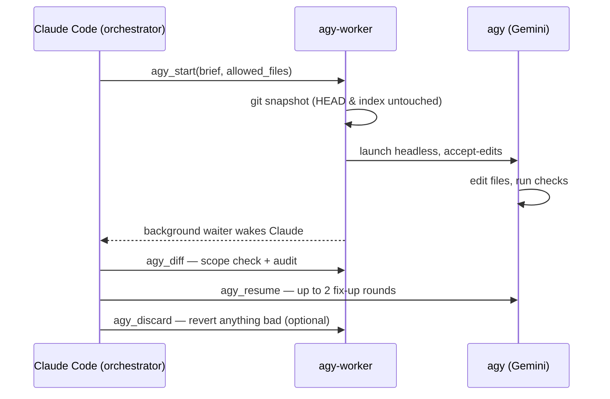

<div align="center">

# 🤖 agy-worker

**Claude Code plans and audits. Antigravity does the work.**

A Claude Code plugin that hands long, multi-task work packages to the Antigravity CLI (`agy`) and audits every change it makes.

 [](LICENSE)     

</div>

## ⚡ How it works

Claude Code plans work packages, monitors progress through a background waiter, and audits every diff. agy runs headlessly in place to execute mechanical file edits and run checks.



## ✨ Why

- **Long work packages, not one-line edits**: Sized for 10–60 minutes of worker runtime so startup overhead is amortised effectively across multiple tasks.
- **In-place edits with snapshot diff/revert**: Works directly in the repository without isolated git worktrees, protected by an independent git snapshot.
- **Clear division of labor**: Claude keeps the judgment, architecture, and auditing; agy does the mechanical work.
- **Token-thrifty**: Preserves turn budgets and context windows using a background waiter, compact status, and tiered diff audits.

## 🚀 Quick start

**Requirements**: Claude Code, `agy` signed in (check with `agy models`), `uv` on `PATH`, git repo for diff/revert.

In Claude Code, run:

```text
/plugin marketplace add Pranavraut033/claude-code-agy-worker
/plugin install agy-worker@agy-worker
```

Restart Claude Code; `/mcp` should list agy-worker.

Then just ask:

> hand this to agy: add type hints to every function in src/ and make mypy pass

## 🧰 Tools

| Tool | Description |
|---|---|
| `agy_start` | Start agy on a work package in place in cwd. |
| `agy_status` | One job's progress: compact state, steps, edits, commands, denied actions, report. |
| `agy_wait` | Block until job finishes or stalls; returns agy_status. |
| `agy_diff` | Audit changed files against snapshot, out-of-scope edits, denied actions, diff. |
| `agy_resume` | Fix-up round: send a message to the same agy conversation. |
| `agy_cancel` | Kill a running job and terminate its process group. |
| `agy_discard` | Restore files from the pre-job snapshot; delete agy-created files. |
| `agy_permissions` | Read or edit agy's headless command and URL allow-list. |
| `agy_usage` | Check remaining 5-hour and weekly quota pools and reset times. |

## 🛡️ Safety

- **Accept-edits mode**: agy is invoked with `--mode accept-edits`; never run with `--dangerously-skip-permissions`.
- **Permissions allow-list**: Enforced via `~/.gemini/antigravity-cli/settings.json` under `permissions.allow` and edited by `agy_permissions`.
- **Guard preamble**: Every brief constrains agy to `allowed_files` and prohibits state-changing git commands, package installs, and file deletions.
- **Audit & discard**: `agy_diff` flags out-of-scope or unrecorded edits; `agy_discard` restores files cleanly from the pre-job snapshot.
- **Safe snapshots & no commits**: Snapshots use a throwaway `GIT_INDEX_FILE` without touching `HEAD` or index; agy commits nothing.

## 🧠 Choosing a model

- **`gemini-3.8-flash-medium`** (Default): Fast, token-efficient, recommended for well-specified refactors, migrations, and scaffolding across all plans.
- **`gemini-3.8-flash-high`**: Suitable for complex multi-step refactoring with subtle dependency orderings.
- **`gemini-4-argon-medium`**: Recommended for open-ended research legwork, transcription, or complex verification; draws from a limited weekly quota pool.

Check quota for free with `agy -p "/usage"` (or the `agy_usage` tool). Full per-model notes and timings: [models.md](skills/agy/references/models.md).

## 📚 More

<details><summary><b>Manual install</b></summary>

1. Copy the skill directory `skills/agy` to `~/.claude/skills/agy`.
2. Add the MCP server directly to your Claude configuration:
   ```bash
   claude mcp add --scope user agy-worker -- uv run --script /path/to/server/server.py
   ```

</details>

<details><summary><b>Work package brief format</b></summary>

```markdown
# Context
Static facts first: what the project is, file formats, where examples live.

# Goal
One paragraph defining the expected end state of this package.

# Tasks
Numbered list. Each task defines target files, exact change, done-means, and machine-readable checks.

# Order & checkpoints
Which tasks depend on which; run checks after each task and resolve failures before proceeding.

# If blocked
Skip the blocked task, record why, and continue with the remaining tasks.

# Report
Per task: done / skipped (why) / check result; files changed.
```

</details>

<details><summary><b>What we learned about headless agy</b></summary>

- **Permission rules are prefixes**: Rules match prefixes (`command(...)`, `read_url(...)`) or regex `command(regex:...)`; wildcard `*` is literal.
- **Denials abort the round**: Unpermitted actions are auto-denied in headless mode and terminate the round immediately.
- **Start fresh jobs after denials**: Resuming after a denial can wedge the session; grant permission via `agy_permissions` and start a new job.
- **Free quota checks**: Running `agy -p "/usage"` queries local CLI quota pools without consuming tokens or model calls.
- **Active commands avoid stalls**: Long-running commands in `ACTIVE` state are tracked so active test or build runs are not flagged as stalled.
- **The process can outlive its result**: agy may keep running after emitting its final `result` event, so job state is taken from the result, not from whether the process is alive.

</details>

<details><summary><b>Configuration & limitations</b></summary>

- **`AGY_WORKER_HOME`**: Directory where job metadata, jsonl streams, and stderr logs are preserved (defaults to `~/.local/state/agy-worker`).
- **Platforms**: tested on macOS. Linux should work (same POSIX process handling) but is untested. Windows is not supported yet: `agy_cancel` uses `os.killpg` and the liveness check uses `os.kill(pid, 0)`.
- **Protected paths**: Claude Code safety boundaries may reject worker file edits within `~/.claude/`.
- **Model quota limits**: Gemini 4 Argon requires a paid tier (Google AI Pro, Ultra, or Enterprise) and operates under a weekly quota pool.

</details>

---

*Unofficial community project, not affiliated with or endorsed by Google or Anthropic. agy-worker edits agy's settings.json allow-list and lets agy edit files in your working tree — review what you grant.*

MIT © 2026 Pranav Raut — see [LICENSE](LICENSE).
