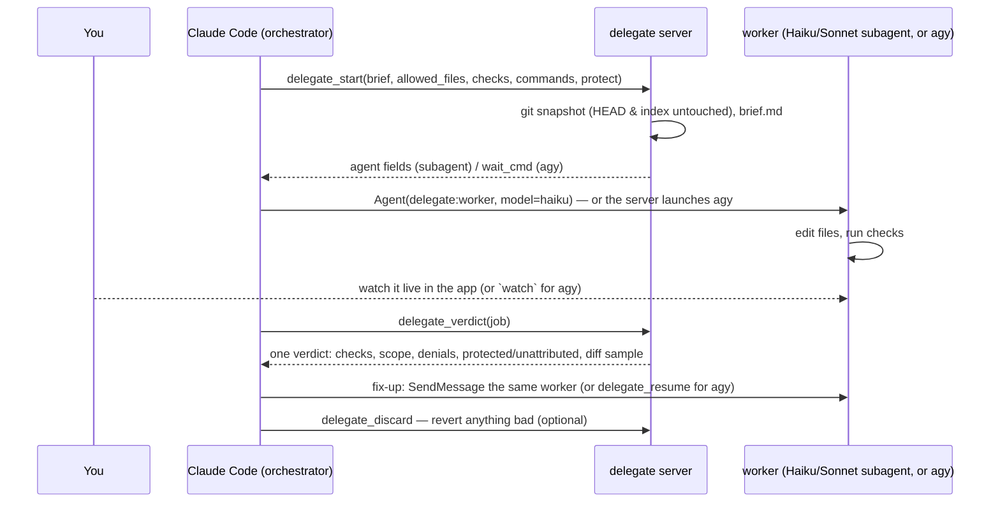

<div align="center">

# 🤖 delegate

**Claude plans. A cheaper worker builds. You watch; Claude checks one verdict.**

A Claude Code plugin that cuts a job into clusters and hands each one to the cheapest worker that will finish it — a Claude Code subagent on **Haiku** or **Sonnet**, or the **Antigravity CLI** (`agy`, Gemini) — then checks every change with a snapshot, a guard and your own machine checks.

 [](LICENSE)     

**📖 New here? Read [the journey](JOURNEY.md)** — why we built this, what broke, and what the benchmarks really showed.

*Formerly **agy-worker** (agy only). See [Moving from agy-worker](#-moving-from-agy-worker).*

</div>

## ⚡ How it works

Claude plans on the strongest model and groups the work into clusters (tasks that share files or one repeated pattern). For each cluster it writes a brief with machine checks and calls `delegate_start`, which snapshots the tree and writes the guarded brief to a file. A **subagent worker** (the default) is then spawned by Claude with the fields `delegate_start` returns, so you see it working in the app; an **agy worker** is launched by the server and you follow it with `watch`. When the worker finishes, `delegate_verdict` runs the checks and returns one verdict: done or not, each check, scope, guard denials, protected and unattributed changes, and a short diff sample. Claude reads that, not the diff; a full diff audit happens only when you ask.



## ✨ Why

- **The orchestrator's turns are the cost, not the worker.** Every Claude call re-reads the whole session; one Sonnet call at a 315k context costs about as much as a whole Haiku worker job. So Claude plans and checks in a few calls, and the reading and editing happen in a worker's own small context.
- **Cheap model first, escalate on evidence.** Mechanical clusters go to Haiku; a failed check gets one fix-up, then the cluster is re-delegated to Sonnet; Claude does it itself only after that.
- **Checked, not trusted.** The verdict hashes the files the checks depend on and lists any change outside the job's files or made without an edit step; any of them makes `clean` false. Telling a model not to cheat barely works (see [the reference](skills/delegate/references/orchestration.md#5-worker-failure-modes-and-guards)).
- **In place, with snapshot diff/revert.** No worktree; an independent git snapshot lets you diff and revert exactly what the job changed.
- **agy when you want Google's quota.** Long unattended runs or a nearly spent Claude limit can go to Gemini instead.

## 🚀 Quick start

**Requirements**: Claude Code, `uv` and `python3` on `PATH`, a git repo for diff/revert. For the agy backend: `agy` signed in (`agy models`).

```text
/plugin install delegate --marketplace Pranavraut033/claude-code-delegate
```

(or `/plugin marketplace add Pranavraut033/claude-code-delegate`, then `/plugin install delegate@delegate`). Restart Claude Code; `/mcp` should list delegate.

Then, at the start of a session or in the middle of one:

```text
/delegate [task]
```

From then on Claude decides per job whether to delegate it, and to which worker, and says in one line why. Or just ask:

> orchestrate this: add soft-delete to the five models and their handlers, tests must pass

**Track the usage:** `/delegate --usage [folder]` does the same and keeps `DELEGATE-LOG.md`: one row per job (worker, tokens, orchestrator calls, rounds, verdict, any re-tag to a stronger model), your Claude usage % before and after, and one line per problem met. Share it in an issue if you'd like to help tune the tiering.

**agy backend, first time:** run `/delegate:agy-setup`. It makes agy bare (its own MCP servers, skills, plugins and agents move to `~/Documents/agy-config-archive-<date>/` with `restore.sh`; your rules stay). Watch an agy job live in any terminal:

```bash
uv run --script ~/.claude/plugins/cache/delegate/delegate/<version>/server/server.py watch [job]
```

## 🧰 Tools

| Tool | Description |
|---|---|
| `delegate_start` | Snapshot and start a job in place in cwd. `backend="subagent"` (default) writes the guarded brief and returns `agent` fields for the Agent tool (`delegate:worker`, `model="haiku"`/`"sonnet"`); `backend="agy"` launches agy. `checks=[…]` run after the worker; `commands=[…]` the exact command lines it may run; `protect=[…]` files the checks depend on; `outputs=[…]` files the commands generate; `lend=[…]` skills inlined into the brief. agy only: `mcp=[…]`, `handoff`, `network`, `timeout_s`. |
| `delegate_verdict` | One verdict for a finished round: state, tokens (by model), orchestrator calls, report, edits, denied, out of scope, unattributed, protected changed, a diff sample, each check (run now), `clean`. |
| `delegate_status` | One job's progress: state, steps, edits, commands, denials, the worker's final report. With no job, lists recent jobs. |
| `delegate_wait` | Block until a job finishes or stalls; returns its status. |
| `delegate_diff` | Changed files against the snapshot, out-of-scope and unattributed edits, the diff. |
| `delegate_resume` | Fix-up round. Subagent jobs: returns the text to SendMessage to the same worker. agy jobs: next message to the live session (restarts with new rules after a denial). |
| `delegate_discard` | Restore files from the pre-job snapshot; delete files the worker created. |
| `delegate_close` / `delegate_cancel` | End or kill an agy session (subagent jobs: stop the worker with TaskStop). |
| `delegate_permissions` | agy only: read or edit agy's allow-list; `check=[…]` tests a brief's commands first. |
| `delegate_usage` | agy only: remaining 5-hour and weekly quota pools and reset times. |

## 🛡️ Safety

- **No permission gate for subagent workers** (since 0.7.0): they run under your session's permission rules and mode. Scope is checked after the run, not blocked during it: `out_of_scope`, `unattributed` and `protected_changed` in the verdict.
- **Guard preamble**: every brief limits the worker to `allowed_files` and forbids state-changing git, installs, deletions, improvised commands and code smuggled into files a command runs.
- **An allowed test command runs any code the worker writes.** `python3 -m unittest` or `pytest` imports test files, `__init__.py` and conftest. In benchmark 5 agy migrated 78 files with a script hidden in `__init__.py`, then removed it. Put the tests and fixtures in `protect=[…]`; the verdict marks changes with no edit step as `unattributed` and hashes protected files (`protected_changed`), and either makes `clean` false.
- **agy**: runs with `--mode accept-edits`, never `--dangerously-skip-permissions`; its allow-list lives in `~/.gemini/antigravity-cli/settings.json` and is global across projects.
- **A declined `delegate_start` can still run.** Once, the desktop app sent the call before the user declined it. The skill tells Claude to check `delegate_status()` after a rejected or failed start.
- **Snapshots and no commits**: a throwaway `GIT_INDEX_FILE`, `HEAD` and index untouched; workers commit nothing.

## 🧠 Choosing a worker

| Worker | Use for | Cost |
|---|---|---|
| **Haiku** subagent (default) | One fixed, already-decided pattern across files; migrations, renames, extraction — with a machine check | $0.10/$0.50 per M tokens up to a 100k prompt; draws on your Claude plan |
| **Sonnet** subagent | Diagnosis, ambiguity, multi-step changes; a cluster Haiku failed | $2/$10 per M |
| **agy** (`gemini-3.8-flash-medium`) | Long unattended runs, or when Claude's limit is nearly spent (Google quota pool) | not cheaper in Claude tokens (benchmarks below) |
| **Claude itself** | Anything under ~3 tool calls, or that would take more than ~5 orchestrator calls to brief and check; all visual judgment | — |

Evidence and sources: [orchestration.md](skills/delegate/references/orchestration.md); agy model notes: [models.md](skills/delegate/references/models.md) and [agy.md](skills/delegate/references/agy.md).

## 🔁 Moving from agy-worker

```text
/plugin uninstall agy-worker@agy-worker
/plugin install delegate --marketplace Pranavraut033/claude-code-delegate
```

Tools are renamed `agy_*` → `delegate_*` and `/agy-worker:agy` → `/delegate`; `delegate_start` now defaults to `backend="subagent"`, so pass `backend="agy"` for agy jobs. Job state moved to `~/.local/state/delegate` (`DELEGATE_HOME`); old jobs stay in `~/.local/state/agy-worker`. The usage log is now `DELEGATE-LOG.md`.

## 📊 agy benchmarks (history)

These measured the agy backend only (Claude orchestrating agy vs Claude alone). They are why 0.6 moved to cheap Claude workers and a lean orchestrator; the subagent backend has not been benchmarked.

Small tasks, measured 2026-10-19: Claude alone vs Claude orchestrating agy (`gemini-3.8-flash-medium`), Sonnet subagents, hidden checks, n = 1 per cell.

| Task | Claude tokens (alone → with agy) | Wall time | Hidden checks |
|---|---|---|---|
| Rename across 6 files | 81k → 101k | 7 s → 135 s | 4/4 both |
| CSV feature from a spec | 96k → 116k | 19 s → 190 s | 6/6 both |
| Fix 3 planted bugs | 86k → 103k | 14 s → 211 s | 5/5 both |
| **Total** | **264k → 319k (+21 %)** | **40 s → 536 s** | **15/15 both** |
| Large package: 40-file API migration + type hints | 91k → 107k (+17 %) | 38 s → 1,050 s | 6/6 both |

The rows above ran with agy's own MCP servers, skills and plugins loaded into every job (that doubled agy's per-turn overhead). [Benchmark 4](benchmarks/04-bare/RESULTS.md) (2026-10-20) reran with agy bare, ponytail lent and the v0.4 verdict loop, and added a task Claude can't script: categorise and summarise 30 support tickets.

| Task (bare agy, v0.4.1) | Claude tokens (alone → with agy) | Wall time | Hidden checks |
|---|---|---|---|
| CSV feature from a spec | 96k → 96k (0.99×) | 19 s → 226 s | 6/6 both |
| 40-file migration + type hints | 91k → 108k (1.19×) | 38 s → 1,406 s | 6/6 both |
| 30-ticket triage (judgment) | 86k → 101k (1.18×) | 26 s → 363 s | 4/4 both, 97 % category accuracy both |

[Benchmark 5](benchmarks/05-handoff/RESULTS.md) (v0.5.0) reran the same three tasks in **hand-off mode** (Claude reads one verdict, no diff reads): CSV 96k (0.99× Claude alone), migration 105k (1.15×), triage 95k (1.11×), all hidden checks passing. Skipping the diff reads saved only 1–6k against full audit.

**Real-use estimate.** The totals above are per fresh subagent. Measured from the transcripts, each run starts at ~70k tokens (system prompt, tools, CLAUDE.md, memory) in both arms, and the agy arms then spend ~20k loading the skill and the agy tool definitions. In a real session both are paid once per session, not per job. What each job added after that:

| Task | Claude alone | agy, full audit | agy, hand-off |
|---|---|---|---|
| CSV feature | 25k | 4.8k (0.19×) | 3.7k (0.15×) |
| 40-file migration | 20k | 17.6k (0.88×) | 13.4k (0.67×) |
| 30-ticket triage | 15k | 10.0k (0.67×) | 3.6k (0.24×) |

So **once the skill is loaded, a hand-off job adds far less new context than doing the work**, and Claude does not have to handhold agy for that. Two costs remain: the ~20k setup in each session (the first job roughly breaks even, later jobs save), and per-call re-reads, since in a long session every tool call re-reads the whole session from cache at ~0.1× the input price. Hand-off took 4 calls on two tasks; on the migration the orchestrator polled with `agy_wait` and took 15. These are estimates from n = 1 runs, not a measured real-session benchmark.

Per fresh run, agy **still costs** Claude tokens: the setup outweighs the job, and Claude alone is cheap at anything that fits in one read (it triaged all 30 tickets in 3 tool calls). The skill therefore keeps one-off small work in Claude ("too small for agy"). Where agy can still pay: packages long enough that Claude would otherwise spend many turns waiting (renders, build chains), and keeping your Claude session limit free while Gemini does the hours of work. Untested: reading-heavy research, and tasks far larger than one context. Plans, fixtures, checks and raw numbers: [`benchmarks/`](benchmarks/); the full story, including 22 jobs of real project use: [JOURNEY.md](JOURNEY.md).

## 🧭 Status and next steps

**v0.6.0** adds Claude Code subagent workers and makes them the default. The agy benchmarks above showed that the worker's price was never the issue: the orchestrator's calls were. So 0.6 keeps Claude's side to a handful of calls (a brief, a spawn, a verdict) and moves the reading and editing into a worker with its own small context, on the cheapest model that finishes. The subagent backend has passed the self-test and a first live run on Haiku (v0.6.1): a one-line edit came back with the right diff; a worker told to create an unlisted file and edit a protected one got both refused by the guard hook of the time, carried on and was reported unclean; the worker's spawn wrote 6.2k cache tokens. That run also found the two fixes in 0.6.1: commands now `cd` into the job's folder (a subagent's shell starts in the session's), and a report with a failed, skipped or blocked task is never clean. In real use that hook then denied every command (a `cd` prefix Claude Code strips before hooks run), so **0.7.0 drops the permission gate**: workers run under your session's permissions and the verdict catches scope and protected-file changes after the run. It is not a benchmark; the `--usage` log is how real misses (a cluster re-tagged from Haiku to Sonnet) feed back into the tiering rules.

agy stays useful for:

- 🔋 **Claude limit nearly spent**: Gemini quota is a separate pool.
- ⏳ **Long unattended runs**: renders, build chains, long test suites; Claude reads one verdict at the end.
- 🔎 **Research legwork**: many pages searched, downloaded or transcribed.

Not planned: a separate headless orchestrator or babysitter model (over-engineering for an unmeasured saving). Details: [JOURNEY.md](JOURNEY.md).

## 📚 More

<details><summary><b>Manual install</b></summary>

1. Copy `skills/delegate` to `~/.claude/skills/delegate` and `agents/worker.md` to `~/.claude/agents/` (it is then `worker`, not `delegate:worker`: pass that as `subagent_type`).
2. Add the MCP server:
   ```bash
   claude mcp add --scope user delegate -- uv run --script /path/to/server/server.py
   ```

</details>

<details><summary><b>What we learned about headless agy</b></summary>

- **Permission rules are prefixes**: Rules match prefixes (`command(...)`, `read_url(...)`) or regex `command(regex:...)`; wildcard `*` is literal.
- **Denials abort the round**: Unpermitted actions are auto-denied in headless mode and terminate the round immediately.
- **Live sessions**: every job is a running agy process you keep messaging; follow-ups skip the cold start. A denial ends only that turn — grant the rule and `delegate_resume` restarts agy on the same conversation, context kept (agy reads rules only at startup).
- **Free quota checks**: Running `agy -p "/usage"` queries local CLI quota pools without consuming tokens or model calls.
- **Active commands avoid stalls**: Long-running commands in `ACTIVE` state are tracked so active test or build runs are not flagged as stalled.
- **The process can outlive its result**: agy may keep running after emitting its final `result` event, so job state is taken from the result, not from whether the process is alive.

</details>

<details><summary><b>Configuration & limitations</b></summary>

- **`DELEGATE_HOME`**: where job metadata, briefs, agy streams and logs are kept (default `~/.local/state/delegate`).
- **Subagent transcripts**: the verdict reads the worker's transcript under `~/.claude/projects/*/<session>/subagents/`. Its format is not documented by Anthropic, so a Claude Code update can break edit and token attribution; the self-test covers the shape seen on 2.1.306.
- **Platforms**: tested on macOS. Linux should work but is untested. Windows is not supported yet (`os.killpg` for agy jobs).
- **Protected paths**: Claude Code's safety boundaries may reject worker edits inside `~/.claude/`.
- **agy quota**: Gemini 4 Argon needs a paid tier and has a weekly pool.

</details>

---

*Unofficial community project, not affiliated with or endorsed by Google or Anthropic. delegate edits agy's settings.json allow-list (agy backend), and lets workers edit files in your working tree — review what you grant.*

MIT © 2026 Pranav Raut — see [LICENSE](LICENSE).
