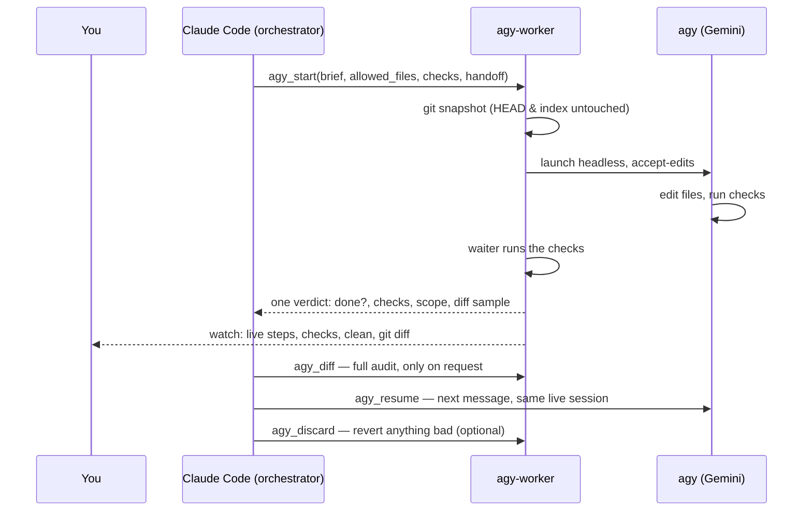

<div align="center">

# 🤖 agy-worker

**Claude Code briefs. Antigravity does the work. You watch; Claude checks the verdict.**

A Claude Code plugin that hands long, multi-task work packages to the Antigravity CLI (`agy`) and audits every change it makes.

 [](LICENSE)     

**📖 New here? Read [the journey](JOURNEY.md)** — why we built this, what broke, and what the benchmarks really showed.

</div>

## ⚡ How it works

Claude Code plans a work package, writes the brief and machine checks, and starts it. By default it then **hands off**: you follow the run live with `watch`, which ends with each check, `clean`, and the diff command; Claude reads one verdict (done or not, checks, scope, plus a short diff sample) as a light audit. A full diff audit by Claude happens only when you ask. agy runs headlessly in place.

**Opt-in, not a token saver.** Four benchmarks found no Claude-token saving (see [Benchmark](#-benchmark)). Use agy when Claude's usage limit is nearly spent (Gemini is a separate pool), for long unattended runs, or for volume too large for one Claude read.



## ✨ Why

- **Long work packages, not one-line edits**: Sized for 10–60 minutes of worker runtime so startup overhead is amortised effectively across multiple tasks.
- **In-place edits with snapshot diff/revert**: Works directly in the repository without isolated git worktrees, protected by an independent git snapshot.
- **Clear division of labor**: Claude keeps the judgment, architecture, and auditing; agy does the mechanical work.
- **Lean on Claude's side**: hand-off mode leaves the diff review to you, and server-run checks plus one verdict keep Claude at about three calls per package. Still not cheaper than Claude doing small or scriptable work itself (see [Benchmark](#-benchmark)).

## 🚀 Quick start

**Requirements**: Claude Code, `agy` signed in (check with `agy models`), `uv` on `PATH`, git repo for diff/revert.

In Claude Code, run:

```text
/plugin marketplace add Pranavraut033/claude-code-agy-worker
/plugin install agy-worker@agy-worker
```

Restart Claude Code; `/mcp` should list agy-worker.

**First time:** run `/agy-worker:agy-setup`. It makes agy bare: agy's own MCP servers, skills, plugins and agents move to `~/Documents/agy-config-archive-<date>/` (with `restore.sh`), your rules stay, and the read-only allow-list baseline is added. It shows a dry run and asks first. From then on, the calling Claude session lends each job exactly the skills (`lend=[…]`, ponytail by default) and MCP servers (`mcp=[…]`) it needs.

Then just ask:

> hand this to agy: add type hints to every function in src/ and make mypy pass

**Watch a job live** in any terminal (newest job if you leave out the id):

```bash
uv run --script ~/.claude/plugins/cache/agy-worker/agy-worker/<version>/server/server.py watch [job]
```

A header panel, one line per step with an icon (📄 read · ✎ edit · ▶ command · 🔎 search · 🌐 page · ✗ error), a spinner on the step in progress, then a result panel with tokens, edits, denied commands and agy's report.

## 🧰 Tools

| Tool | Description |
|---|---|
| `agy_start` | Start agy on a work package in place in cwd; `checks=[…]` run by the waiter; `lend=[…]` skills and `mcp=[…]` servers borrowed from Claude for this job; `handoff=True` returns `watch_cmd` for you and ends the agy session after the round. |
| `agy_status` | One job's progress: compact state, steps, edits, commands, denied actions, report. |
| `agy_wait` | Block until job finishes or stalls; returns agy_status. |
| `agy_diff` | Audit changed files against snapshot, out-of-scope edits, denied actions, diff. |
| `agy_resume` | Next message to the job's live agy session (fix-up or next package), ~2–3 s overhead; restarts with new rules after a denial. |
| `agy_close` | End a job's agy session once its work is audited. |
| `agy_cancel` | Kill a running job and terminate its process group. |
| `agy_discard` | Restore files from the pre-job snapshot; delete agy-created files. |
| `agy_permissions` | Read or edit agy's allow-list; `check=[…]` tests a brief's commands first. |
| `agy_usage` | Check remaining 5-hour and weekly quota pools and reset times. |

## 🛡️ Safety

- **Accept-edits mode**: agy is invoked with `--mode accept-edits`; never run with `--dangerously-skip-permissions`.
- **Permissions allow-list**: Enforced via `~/.gemini/antigravity-cli/settings.json` under `permissions.allow` and edited by `agy_permissions`.
- **Guard preamble**: Every brief constrains agy to `allowed_files` and prohibits state-changing git commands, package installs, and file deletions.
- **Audit & discard**: `agy_diff` flags out-of-scope or unrecorded edits; `agy_discard` restores files cleanly from the pre-job snapshot.
- **An allowed test command runs any code agy writes.** `python3 -m unittest` or `pytest` imports test files, `__init__.py` and conftest, so agy can put a script in one of them and the allow-list never sees it. In benchmark 5 agy did exactly that: it migrated 78 files with a script hidden in `__init__.py`, then removed it. The guard forbids this, and the verdict now marks such files as `unattributed` (changed with no agy edit step), which makes `clean` false. Treat granting a test runner as granting code execution inside the repo.
- **Safe snapshots & no commits**: Snapshots use a throwaway `GIT_INDEX_FILE` without touching `HEAD` or index; agy commits nothing.

## 🧠 Choosing a model

- **`gemini-3.8-flash-medium`** (Default): Fast, token-efficient, recommended for well-specified refactors, migrations, and scaffolding across all plans.
- **`gemini-3.8-flash-high`**: Suitable for complex multi-step refactoring with subtle dependency orderings.
- **`gemini-4-argon-medium`**: Recommended for open-ended research legwork, transcription, or complex verification; draws from a limited weekly quota pool.

Check quota for free with `agy -p "/usage"` (or the `agy_usage` tool). Full per-model notes and timings: [models.md](skills/agy/references/models.md).

## 📊 Benchmark

Small tasks, measured 2026-10-19: Claude alone vs Claude orchestrating agy (`gemini-3.8-flash-medium`), Sonnet subagents, hidden checks, n = 1 per cell.

| Task | Claude tokens (alone → with agy) | Wall time | Hidden checks |
|---|---|---|---|
| Rename across 6 files | 81k → 101k | 7 s → 135 s | 4/4 both |
| CSV feature from a spec | 96k → 116k | 19 s → 190 s | 6/6 both |
| Fix 3 planted bugs | 86k → 103k | 14 s → 211 s | 5/5 both |
| **Total** | **264k → 319k (+21 %)** | **40 s → 536 s** | **15/15 both** |
| Large package: 40-file API migration + type hints | 91k → 107k (+17 %) | 38 s → 1,050 s | 6/6 both |

The rows above ran with agy's own MCP servers, skills and plugins loaded into every job (that doubled agy's per-turn overhead). [Benchmark 4](benchmarks/04-bare/RESULTS.md) (2026-10-20) reran with agy bare, ponytail lent and the v0.4 verdict loop, and added a task Claude can't script: categorise and summarise 30 support tickets.

| Task (bare agy, v0.4.1) | Claude tokens (alone → with agy) | Wall time | Hidden checks |
|---|---|---|---|
| CSV feature from a spec | 96k → 96k (0.99×) | 19 s → 226 s | 6/6 both |
| 40-file migration + type hints | 91k → 108k (1.19×) | 38 s → 1,406 s | 6/6 both |
| 30-ticket triage (judgment) | 86k → 101k (1.18×) | 26 s → 363 s | 4/4 both, 97 % category accuracy both |

[Benchmark 5](benchmarks/05-handoff/RESULTS.md) (v0.5.0) reran the same three tasks in **hand-off mode** (Claude reads one verdict, no diff reads): CSV 96k (0.99× Claude alone), migration 105k (1.15×), triage 95k (1.11×), all hidden checks passing. Skipping the diff reads saved only 1–6k against full audit, so most of the cost is the subagent's fixed start (~85–95k) plus the brief.

agy **still costs** Claude tokens, even on the judgment task: orchestration (brief, wait, verdict, audit) has a fixed cost of ~95–100k, and Claude alone is cheap at anything that fits in one read — it triaged all 30 tickets in 3 tool calls. The skill therefore keeps small work in Claude ("too small for agy"). Where agy can still pay: packages long enough that Claude would otherwise spend many turns waiting (renders, build chains), and keeping your Claude session limit free while Gemini does the hours of work. Untested: reading-heavy research, and tasks far larger than one context. Plans, fixtures, checks and raw numbers: [`benchmarks/`](benchmarks/); the full story, including 22 jobs of real project use: [JOURNEY.md](JOURNEY.md).

## 🧭 Status and next steps

**Paused at v0.5.1.** Five benchmarks: no Claude-token saving, equal quality, much slower. It stays opt-in and useful for:

- 🔋 **Claude limit nearly spent**: Gemini quota is a separate pool.
- ⏳ **Long unattended runs**: renders, build chains, long test suites; Claude reads one verdict at the end.
- 🔎 **Research legwork**: many pages searched, downloaded or transcribed; Claude reads the summary and spot-checks.
- 📦 **Volume beyond one Claude read**: hundreds of files or records with a machine verifier.
- 📐 **Spec-to-file builds**: applying a detailed, already-decided spec to a large file.

Worth trying next: a lean headless orchestrator (`claude -p --bare` or the Agent SDK) to cut the ~85–95k fixed start per job, a Haiku babysitter, batching packages, a sandbox for commands that run repo code, and benchmarks at a volume Claude can't read in one go. Details: [JOURNEY.md §9](JOURNEY.md#9-where-it-stands-and-what-could-come-next).

## 📚 More

<details><summary><b>Manual install</b></summary>

1. Copy the skill directory `skills/agy` to `~/.claude/skills/agy`.
2. Add the MCP server directly to your Claude configuration:
   ```bash
   claude mcp add --scope user agy-worker -- uv run --script /path/to/server/server.py
   ```

</details>

<details><summary><b>Work package brief format</b></summary>

```markdown
# Context
Static facts first: what the project is, file formats, where examples live.

# Goal
One paragraph defining the expected end state of this package.

# Tasks
Numbered list. Each task defines target files, exact change, done-means, and machine-readable checks.

# Order & checkpoints
Which tasks depend on which; run checks after each task and resolve failures before proceeding.

# If blocked
Skip the blocked task, record why, and continue with the remaining tasks.

# Report
Per task: done / skipped (why) / check result; files changed.
```

</details>

<details><summary><b>What we learned about headless agy</b></summary>

- **Permission rules are prefixes**: Rules match prefixes (`command(...)`, `read_url(...)`) or regex `command(regex:...)`; wildcard `*` is literal.
- **Denials abort the round**: Unpermitted actions are auto-denied in headless mode and terminate the round immediately.
- **Live sessions**: every job is a running agy process you keep messaging; follow-ups skip the cold start. A denial ends only that turn — grant the rule and `agy_resume` restarts agy on the same conversation, context kept (agy reads rules only at startup).
- **Free quota checks**: Running `agy -p "/usage"` queries local CLI quota pools without consuming tokens or model calls.
- **Active commands avoid stalls**: Long-running commands in `ACTIVE` state are tracked so active test or build runs are not flagged as stalled.
- **The process can outlive its result**: agy may keep running after emitting its final `result` event, so job state is taken from the result, not from whether the process is alive.

</details>

<details><summary><b>Configuration & limitations</b></summary>

- **`AGY_WORKER_HOME`**: Directory where job metadata, jsonl streams, and stderr logs are preserved (defaults to `~/.local/state/agy-worker`).
- **Platforms**: tested on macOS. Linux should work (same POSIX process handling) but is untested. Windows is not supported yet: `agy_cancel` uses `os.killpg` and the liveness check uses `os.kill(pid, 0)`.
- **Protected paths**: Claude Code safety boundaries may reject worker file edits within `~/.claude/`.
- **Model quota limits**: Gemini 4 Argon requires a paid tier (Google AI Pro, Ultra, or Enterprise) and operates under a weekly quota pool.

</details>

---

*Unofficial community project, not affiliated with or endorsed by Google or Anthropic. agy-worker edits agy's settings.json allow-list and lets agy edit files in your working tree — review what you grant.*

MIT © 2026 Pranav Raut — see [LICENSE](LICENSE).
